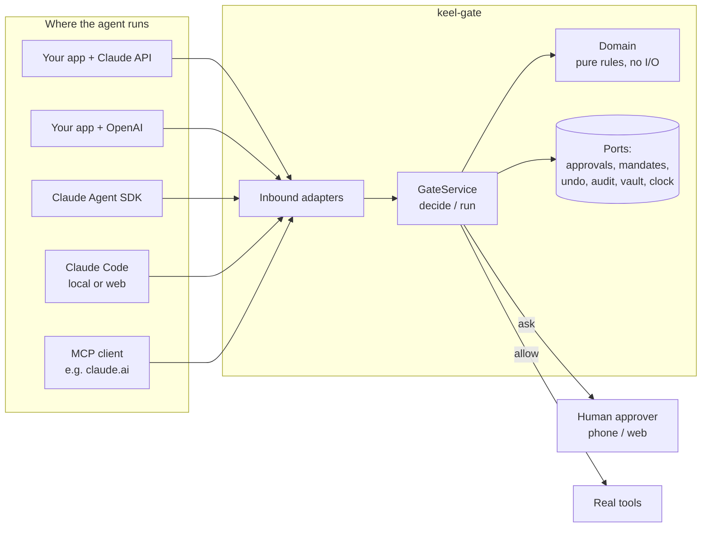
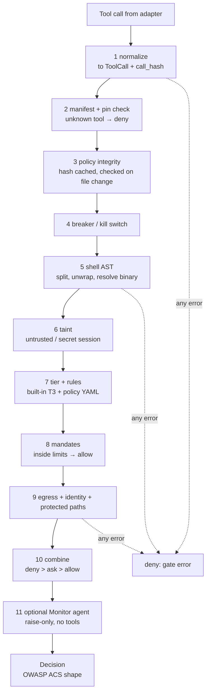

# Architecture

**In one sentence:** keel-gate is a small, pure decision engine with adapters around it. Every tool call from any agent
goes through the same `decide()` before it can run.

## The big picture

## Layers (hexagonal, also called "ports and adapters")

| Layer | Folder | Does | Must not |
|---|---|---|---|
| **Domain** | `keel_gate/domain/` | Pure logic: models, shell parsing, tiers, taint, mandates math, `combine()` | Do I/O, read the clock, or import FastAPI, SQLite, or SDKs |
| **Application** | `keel_gate/gate.py` | `GateService.decide()` runs the pipeline; `run()` = decide, then execute, then audit | Hold HTTP or SDK details |
| **Ports** | `keel_gate/ports.py` | Interfaces: `ApprovalStore`, `MandateStore`, `UndoJournal`, `AuditSink`, `CredentialVault`, `Clock`, `Notifier` | Contain logic |
| **Infrastructure** | `keel_gate/infra/` | SQLite stores, the JSONL audit chain, the env/file vault, the system clock, the web-inbox notifier | Make decisions |
| **Inbound adapters** | `keel_gate/adapters/` | Turn each framework's tool call into a `ToolCall`, and a `Decision` back into that framework's answer | Make decisions |
| **Server** | `keel_gate/server.py` + `templates/` | FastAPI Gate Service + approval / mandate / console pages | Skip `GateService` |

**Dependency rule:** arrows point inward only. The domain imports nothing from the outer layers. This keeps `decide()` fast,
easy to test, and the same in every deployment.

> Small change from the first plan: the adapters live in `keel_gate/adapters/` (inside the package), not in a top-level
> `adapters/` folder. A top-level package named `adapters` would clash with other libraries after `pip install`.

## The decision pipeline

Every step can only **raise** the risk. Nothing later in the pipeline can lower it.

After the decision, `GateService.run()` does:

- `allow` → take credentials from the vault → save an undo record (T1) → run the tool → run the postcheck → write audit
- `ask` → create an approval (binding code, TTL) → notify the human → return `message_for_model` (the agent waits or stops)
- `deny` → write audit → return `message_for_model` as a tool error, so the model can change its plan

## Module map (who owns which acceptance criteria)

| Module | Owns |
|---|---|
| `domain/models.py` | `ToolCall`, `Session`, `Decision`, `Verdict`, `Tier`, `Taint` (AC-001) |
| `domain/canonical.py` | canonical JSON + `call_hash` (AC-006, AC-007) |
| `domain/shell_ast.py` | split, unwrap, resolve, substitution and injection flags (AC-010 – AC-015) |
| `domain/classify.py` | built-in tiers and T3 rules (AC-020 – AC-024) |
| `domain/policy.py` | policy YAML model and matching (AC-025) |
| `domain/manifest.py` | tool manifest + pins (AC-090, AC-091) |
| `domain/taint.py` | taint state and tier raise (AC-060 – AC-063) |
| `domain/mandates.py` | the limit math (AC-050, AC-051, AC-053) |
| `domain/egress.py` | host lists, IP classes, DNS-exfil patterns (AC-070 – AC-072) |
| `domain/paths.py` | protected paths, case and symlink handling (AC-030) |
| `domain/combine.py` | most restrictive verdict wins (AC-002) |
| `domain/sql.py` | read / write / destructive SQL (AC-023) |
| `domain/schema.py` | the strict JSON Schema subset (AC-005) |
| `domain/rules.py` | custom rules compiled into an immutable index by tool name; floor check (AC-190, AC-197, AC-200) |
| `domain/draft.py` | draft manifests from MCP / Claude / OpenAI tool definitions (AC-185 – AC-188) |
| `domain/review.py` | the Monitor agent's pure parts: settings, what it sees, strict answers, canaries (AC-210 – AC-224) |
| `domain/redact.py` | secret redaction before data leaves the gate (AC-217, later AC-131) |
| `monitor.py` | `MonitoredGate`: rules first, then the optional raise-only Monitor agent, with timeout, cache, self-check (AC-210 – AC-224) |
| `adapters/claude_monitor.py` | the Monitor agent on Claude: fixed request keys, no tools, strict JSON answers (AC-218, AC-222, AC-223) |
| `gate.py` | the pipeline, fail-closed wrapper, time budget, observe mode, atomic index swap (AC-003 – AC-005, AC-031, AC-032, AC-080 – AC-082, AC-100 – AC-112, AC-180 – AC-184, AC-199) |
| `domain/naming.py` | one tool name for every framework (`server__tool`, `mcp__server__tool` → `server.tool`) (AC-006) |
| `policy_store.py` | versions, rollback, change records, git-only guard; tells the gate at once (AC-191 – AC-199) |
| `infra/policy_files.py` | saves the store to `policies/custom.yaml` and SQLite; picks up hand edits (planned) |
| `tokens.py` + `infra/approvals_sqlite.py` | approvals and one-time tokens (AC-040 – AC-047) |
| `infra/mandates_sqlite.py` | atomic budget updates (AC-052) |
| `infra/undo_sqlite.py` | undo journal (AC-120) |
| `infra/audit_jsonl.py` | hash chain + redaction (AC-130, AC-131) |
| `adapters/*` | AC-140 – AC-144 |
| `server.py` | AC-150 – AC-154, AC-195, AC-198 (rule and tool endpoints, step-up) |
| `report.py` | AC-170 |

## Where each concern lives

| Concern | Place |
|---|---|
| Authentication (agent key, human session) | server middleware |
| Authorization (agent vs human, approver ≠ requester) | `server.py` dependencies + `tokens.py` |
| Input validation | Pydantic models (`DecideRequest`, `CreateMandateRequest`) + the tool's JSON schema |
| Business rules | `domain/` |
| Output shaping and redaction | `infra/audit_jsonl.py` (redaction) and the response models |
| Rate limiting | server middleware |
| Audit | `AuditSink` port, called only by `GateService` |

## Data

| Store | What | Why this choice |
|---|---|---|
| `approvals` (SQLite, WAL) | pending, approved, used, and expired approvals | `UPDATE … WHERE status='approved'` gives atomic single use |
| `mandates` (SQLite) | limits, spent, uses | an atomic `UPDATE … WHERE spent + :amt <= budget` |
| `undo` (SQLite) | before/after per T1 call | ordered rollback |
| `audit.jsonl` | one line per decision, `prev_hash` → `entry_hash` | append-only and easy to verify by hand |
| `policies/custom.yaml` | custom rules written by the gate for policy admins | human-readable and diffable in git |
| `policy_versions` (SQLite) | every rule and tool change: who, when, before, after, policy hash | one-step rollback |

## Modes

| Mode | What happens |
|---|---|
| `enforce` (default) | ask and deny are enforced |
| `observe` | only the safety floor denies; everything else runs and is logged with `observed_verdict` (ADR 0009) |

## Deployment modes (same core everywhere)

| Mode | How |
|---|---|
| **In-process library** | `Gate.from_dir("policies/")` inside your agent app; the fastest path |
| **Claude Code hook** | `keel-gate hook` as a `PreToolUse` command (exit 2 = deny) |
| **Gate Service** | `docker compose up`; adapters call `POST /v1/decide`; humans approve in the web inbox |
| **MCP proxy** | `keel-gate mcp-proxy` in front of real MCP servers; works for claude.ai custom connectors when hosted on HTTPS |
| **Cloud Claude Code** | an `http` hook to the Gate Service with `onFailure: "block"` |

## Speed design (AC-160, AC-200)

- Policies and manifests compile once at load (dict by tool name, pre-compiled regex).
- Custom rules compile into an **immutable index**: a dict by exact tool name plus a short list of glob rules. A change
  builds a new index and swaps it in one atomic step, so `decide()` never takes a lock and only looks at its own
  tool's rules (1,000 rules cost about the same as 10).
- UI and CLI changes apply to the next decision; hand edits are picked up by an mtime check at most every 0.5 s.
- The policy hash is checked again only when the file's mtime changes.
- The shell parser runs only for shell tools; results are cached per command string (LRU).
- The audit log is written by one background writer, so `decide()` never waits on disk.
- Only `ask` touches the network, and that waits for a human anyway.

## Reused code

Ported from keel v2 (MIT). Each ported file names its source in a header comment.

| keel-gate | From keel v2 |
|---|---|
| `adapters/claude_code_hook.py` | `engine/keel_engine/hook.py` (fail closed, tool-name normalizing) |
| `tokens.py` | `engine/keel_engine/mcp_confirm.py` (`Tokens`, `OUT_OF_BAND`) |
| `infra/approvals_sqlite.py` | `engine/keel_engine/approvals.py`, `V16__approvals.sql` |
| `adapters/mcp_proxy.py` | `engine/keel_engine/mcp_gateway.py`, `mcp_levels.py` |
| `domain/classify.py` | `engine/keel_engine/runtime/permissions.py` (`DESTRUCTIVE`) |
| `domain/policy.py` | `engine/keel_engine/rules/` (bash/edit/mcp/secrets parts only) |
| `gate.py` integrity part | `engine/keel_engine/runtime/guard_ctx.py` |
| `tests/ported/` | `engine/tests/test_hook.py`, `test_guard_security.py`, `test_approvals.py`, `test_mcp_gateway.py`, `test_secret_reads.py` |

Ideas from an earlier private project: an undo log, "propose, don't run" actions, and a claim checker.
