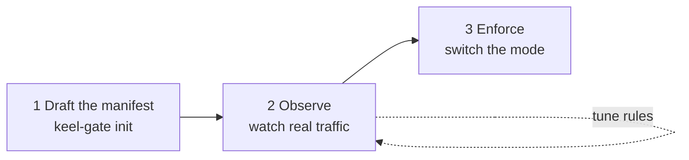

# Add keel-gate to an existing system

You do **not** rebuild your agent. keel-gate plugs in at the one place every agent system already has: **the spot
where tools get run**. Your models, prompts, and tools stay the same.

> **Status:** the design is approved (Spec 001, Amendment A1). The commands below are the target; they ship with the
> adapters (Day 3).

## Pick your level of change

```text
LEVEL 0: config only (no code change)
  Claude Code ........ add one PreToolUse hook to .claude/settings.json
  MCP tools .......... point the client at `keel-gate mcp-proxy` instead of the real server (one URL)

LEVEL 1: one line in your app (Python)
  before:  result = run_tool(name, args)
  after:   result = gate.run(name, args, run_tool, session)

LEVEL 2: other languages (Kotlin, Node, Go …)
  before running a tool:  POST /v1/decide  →  allow / ask / deny   (5–10 lines)
```

| Your stack | Level | Guide |
|---|---|---|
| Claude Code (local or on the web) | 0 | [Protect Claude Code](protect-claude-code.md) |
| Any MCP client (claude.ai, Claude Desktop, IDEs) | 0 | [Protect MCP tools](protect-mcp-tools.md) |
| Python app on the Claude API, Agent SDK, LangGraph, OpenAI Agents SDK | 1 | [Claude API app](protect-claude-api-app.md) · [OpenAI app](protect-openai-app.md) |
| Any other language, or many agents | 2 | [Run the Gate Service](run-gate-service.md) |

## Roll it out in three safe steps



### 1. Draft the manifest from what you already have

keel-gate needs to know your tools. You do not write that by hand:

```bash
uv run keel-gate init --from-mcp "npx my-mcp-server"     # reads tools/list
uv run keel-gate init --from-tools tools.json --format claude   # or openai
```

This writes `manifests/draft.yaml`:
- MCP hints are used as they are (`readOnlyHint`, `destructiveHint`, `openWorldHint`).
- A tool **without hints** is drafted as "ask", because keel-gate never guesses risk from a name.
- Anything removed from a schema is listed as a review note.

### 2. Observe: watch before you block

```yaml
# keel-gate.yaml
mode: observe
```

In observe mode, keel-gate **still blocks the catastrophic actions**: `rm -rf ~`, `DROP TABLE`, a force-push to `main`,
a cloud volume delete, a changed tool definition, and its own errors. Everything else runs, and the report shows what
**would** have been asked or blocked:

```text
10:42:07  support-agent  payments.refund $500   would ask  (over the $100 mandate cap)
10:43:12  dev-agent      npm test               would ask  (unknown program)  ← add an allow rule
10:44:30  ops-agent      deploy.run             unknown tool ← review its manifest entry
```

Fix what you see in the [policy manager](manage-rules-and-tools.md): allow `npm test`, review drafted tools, set a
mandate for small refunds.

### 3. Enforce

```yaml
mode: enforce
```

A draft manifest cannot be enforced by accident: in enforce mode the gate refuses to start until the draft is
reviewed.

## What does not change

- Your tool code and its credentials. With Level 2, keel-gate can hold the credentials so the agent never sees them.
- Your prompts and models.
- How a blocked call looks to the model: a normal tool error with a reason, so the agent can choose a safer path.
