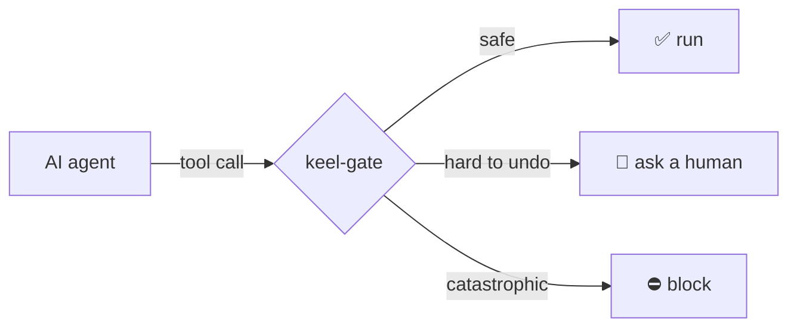

# keel-gate

**A safety brake between AI agents and their tools. It stops actions you can't undo.**

AI agents can run commands, send emails, and move money. Sometimes they do the dangerous thing first and notice the risk
later. keel-gate checks **every tool call before it runs**, outside the model, and **fails closed** when anything is unclear.

## Start here

| I want to… | Read |
|---|---|
| understand it in 5 minutes | [How it works](how-it-works.md) |
| try it | [Getting started](getting-started.md) |
| add it to a system I already run | [Add to an existing system](guides/integrate-existing-systems.md) |
| add, change, or remove rules and tools | [Manage rules and tools](guides/manage-rules-and-tools.md) |
| protect my Claude Code / Claude API / OpenAI / MCP agent | [Guides](guides/protect-claude-code.md) |
| see the proof | [Red-team results](red-team.md) · [Benchmarks](benchmarks.md) |
| know the limits | [Limitations](limitations.md) |
| check the design | [Spec](specs/SPEC-001-keel-gate.md) · [Architecture](architecture.md) · [Threat model](threat-model.md) · [Decisions (ADRs)](adr/0001-harness-not-agent.md) |
| see why it is built this way | [Research](research.md) |
| look up a word | [Glossary](glossary.md) |

## What makes it different

- **Fail closed.** Errors, unknown tools, and unparseable commands are never allowed.
- **Approvals bound to the exact action.** One human "yes" = one call, once, for 5 minutes.
- **Mandates.** Routine actions run inside limits a human set before (cap, budget, payees, expiry).
- **Taint tracking.** After the agent reads untrusted text, risky actions get stricter.
- **A tamper-evident log.** Every decision is hash-chained and can be checked by anyone.
- **Works everywhere.** Claude API, Claude Code (local and web), Agent SDK, OpenAI, MCP, or as a web service.
- **Easy to adopt and manage.** Start in observe mode, draft the manifest from your existing tools, and add or remove
  rules in seconds, with versions and one-step rollback. See [add to an existing system](guides/integrate-existing-systems.md).
