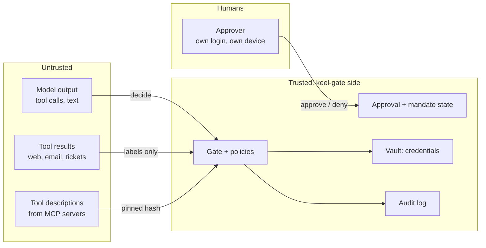

# Threat model

What can go wrong, who might cause it, and which part of keel-gate stops it.

## What we protect

| Asset | Example |
|---|---|
| Data | production databases, customer records, source code |
| Money | refunds, transfers, payments |
| Systems | servers, cloud volumes, deploys, git history |
| Trust | messages sent in the company's name, promises to customers |
| Secrets | API keys, tokens, `.env` files |
| The gate itself | policies, manifests, approvals, the audit log |

## Who or what can cause harm

| Actor | How |
|---|---|
| **The agent itself** (no attacker) | misreads the task, acts too fast, does not notice a failed step (Replit, Antigravity, Gemini CLI) |
| **Injected content** | text in a web page, email, ticket, issue, or tool description that steers the agent (GitHub MCP, Supabase MCP) |
| **A malicious tool or package** | an MCP server changes its description ("rug pull"); malware runs the agent with all checks off (Nx "s1ngularity") |
| **A tired human** | approves everything (users accept about 93% of prompts, per Anthropic) |
| **An outsider** | calls the Gate Service API, replays an approval, or edits the log |

## Trust boundaries

**Rule:** nothing from the untrusted side can approve, change policy, or lower a tier. Only a human, through their own login,
can approve, and only one exact call at a time.

## STRIDE

| Threat | Example | Stopped by | AC |
|---|---|---|---|
| **S**poofing | the agent pretends to be a human approver | separate human session + CSRF; agent keys get 403 on `/approve` | AC-044, AC-151 |
| **T**ampering | the agent edits its policy, hooks, or `.mcp.json` | protected paths, policy hash pin, tool pins | AC-030, AC-031, AC-091 |
| **R**epudiation | "the agent never did that" | hash-chained audit log + `verify` | AC-130, AC-154 |
| **I**nformation disclosure | secrets leaked by `curl`, DNS, or an upload | secret taint, egress lists, DNS patterns, vault | AC-062, AC-070 – AC-072, AC-081 |
| **D**enial of service | runaway loops, approval spam | breaker, rate limits, kill switch | AC-100, AC-101 |
| **E**levation of privilege | the agent uses prod creds, or another customer's data | vault, protected environments, identity from the session | AC-080 – AC-082 |
| **E**levation of privilege | the agent calls the rule API to allow itself | agent keys get 403; only policy admins with step-up can change rules | AC-195 |
| **T**ampering | injected text in the call's arguments tells the Monitor agent to answer "fits" | the monitor can only raise; data blocks cannot be closed from inside; it never sees tool results | AC-213, AC-216, AC-218 |
| **E**levation of privilege | the Monitor agent itself acts (calls a tool) | the request has no tools; any answer other than one JSON object is rejected and asks a human | AC-222, AC-223 |
| **D**enial of service | the Monitor agent is down or slow | hard timeout, no retries; the call asks a human (never allow) | AC-214, AC-220 |
| **I**nformation disclosure | call data sent to the model API | the monitor is off by default; secrets redacted before sending | AC-210, AC-217 |
| **T**ampering | a stolen admin session weakens the rules | step-up, separate admin role, audit + one-step rollback, the safety floor no rule can lower, optional git-only | AC-192, AC-196 – AC-198 |

## OWASP Top 10 for LLM Applications (2025)

| Risk | How keel-gate helps |
|---|---|
| LLM01 Prompt Injection | taint tracking; tool output is never authority (AC-060 – AC-063) |
| LLM02 Sensitive Information Disclosure | secret taint, egress control, redaction (AC-062, AC-070, AC-131) |
| LLM03 Supply Chain | tool pinning (AC-091) |
| LLM05 Improper Output Handling | shell parsing; model output is never run without a decision (AC-010 – AC-015) |
| LLM06 Excessive Agency | the whole gate: least privilege, tiers, human approval, mandates |
| LLM10 Unbounded Consumption | breaker, mandates' budgets, rate limits |

## OWASP Top 10 for Agentic Applications (Dec 2025)

> The ids and names below follow the published list as reported in secondary sources. Check them against the official
> document before the final submission.

| Risk | keel-gate control |
|---|---|
| ASI01 Agent goal hijack | taint raise; tool output has no authority; the optional Monitor agent checks each call against the user's task |
| ASI02 Tool misuse and exploitation | manifest, tiers, shell AST, egress |
| ASI03 Identity and privilege abuse | vault, identity from the session, protected environments |
| ASI04 Agentic supply chain | tool pins, unknown tool = deny |
| ASI05 Unexpected code execution | shell parsing, "decode then run" detection |
| ASI06 Memory and context poisoning | memory and tool text cannot grant or widen permissions; T2/T3 never become standing grants |
| ASI07 Insecure inter-agent communication | every agent gets its own key and session; decisions are per call |
| ASI08 Cascading failures | breaker, postchecks block the rest of the chain |
| ASI09 Human-agent trust exploitation | binding codes, plain-words summaries, "unusual" flag, false-claim marks |
| ASI10 Rogue agents | kill switch, audit, deny by default |

## Google SAIF agent self-assessment: our answers

| SAIF question | Answer |
|---|---|
| Does each agent have its own scoped identity? | Yes: an agent key per agent; `agent_id` and `on_behalf_of` come from the session (AC-080). |
| Are agent actions logged? | Yes: hash-chained audit with reasons and rules (AC-130). |
| Is there a human in or on the loop? | Yes: T2 = human in the loop; mandates = human on the loop with limits (AC-040, AC-050). |
| Model-level safety? | Out of scope for the gate; we assume the model can be wrong or steered. |
| Guardrails inside tools? | The gate runs tools with gate-held credentials and postchecks (AC-081, AC-112). |
| Input/output screening? | Taint labels; the optional Monitor agent judges each call against the task and can only raise risk (AC-210 – AC-224). |
| Tested against prompt injection? | Yes: red-team suite with real incidents (see [red-team](red-team.md)). |

## What we do NOT stop (honest limits)

- A tool that **lies about itself** in a way its manifest cannot express (the manifest is trusted input written by humans).
- Harm done **inside an allowed action** (for example, a correct-looking but wrong refund amount within the mandate).
- Attacks on the **machine itself** if the agent runs with no OS sandbox. We recommend the Claude Code / Codex sandbox or the
  Docker agent box as an extra wall.
- A **human who approves a bad action** on purpose. We make it hard to do by mistake, not impossible to do on purpose.

See [limitations](limitations.md).
